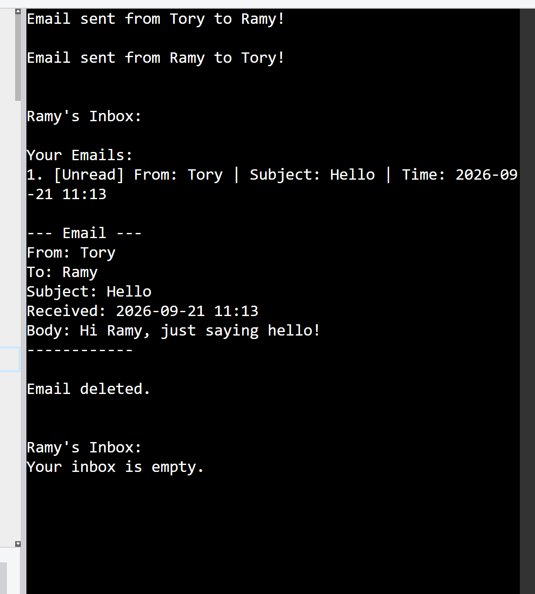

# Email Management System

A simple, console-based email management system built with Python using Object-Oriented Programming (OOP).

This project simulates basic email operations, including sending, receiving, viewing, reading, and deleting emails.

## Features

* Create users with individual inboxes.
* Send emails between users.
* View the list of received emails.
* Display the full content of an email.
* Mark emails as read when opened.
* Delete emails from the inbox.
* Display email timestamps.

## Technologies Used

* Python 3
* Object-Oriented Programming (OOP)
* Python `datetime` module

## Project Structure

```text
email-management-system/
│
├── email_app.py
└── README.md
```

## How to Run

### 1. Install Python

Make sure Python 3 is installed on your computer.

### 2. Download or clone this repository

Clone the repository using:

```bash
git clone YOUR_REPOSITORY_URL
```

Replace `YOUR_REPOSITORY_URL` with your GitHub repository URL.

### 3. Open the project folder

```bash
cd email-management-system
```

### 4. Run the program

```bash
python email_app.py
```

If your system uses the `python3` command, run:

```bash
python3 email_app.py
```

## How It Works

The project contains three main classes:

### 1. Email

Represents an individual email.

It stores the sender, receiver, subject, body, timestamp, and read status.

### 2. User

Represents a user of the email system.

Each user has an inbox and can send emails, check their inbox, read emails, and delete emails.

### 3. Inbox

Stores received emails and provides methods to list, read, and delete them.

## Example

The program creates two users: Tory and Ramy.

Tory sends an email to Ramy, and Ramy replies.

The program then displays Ramy's inbox, opens the first email, deletes it, and displays the inbox again.

## Concepts Practiced

* Classes and objects
* Constructors (`__init__`)
* Instance attributes and methods
* Object relationships
* Lists and list indexing
* Conditional statements
* Loops and `enumerate()`
* Special methods (`__str__`)
* Date and time formatting
* Basic program organization using `main()`

## Note

This is a beginner-level learning project. Emails are stored in memory while the program is running. The project does not use a database, a graphical interface, or a real email delivery service.

## Screenshot

Here is a demonstration of the Email Management System:

